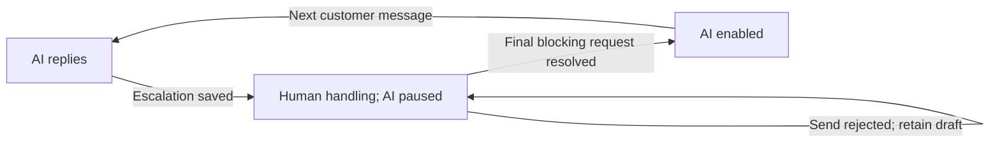

# Channel replacement and customer-service handoff

## Approved behavior

The user approved the cross-channel prototype on 2026-09-14 and authorized deployment to
https://aibot-chatbot-my.fly.dev. AI resumes **only after Resolve**. An existing
connection remains enabled until its replacement is verified successfully.

1. In Publish, choose Telegram, WhatsApp Business, or WhatsApp (linked device). To replace an
   existing account, choose **Change bot** or **Change number**.
2. Telegram requires the new bot token. Meta requires the expected phone number
   and authorization through Meta or the existing Cloud API credentials for that
   number. The verified Meta number, WABA and app subscription must match.
3. Linked devices require a phone number and explicit risk consent. Enter the pairing code in WhatsApp. Disconnect the current device before connecting another number.
4. A failed or pending replacement remains visible with its own identity and
   next step. The previous connection stays enabled. Successful verification
   switches accounts atomically and releases the previous connected row.
5. Conversations retain the provider and channel identity that received them.
   A replacement number cannot send replies for another account's conversation.

Telegram also binds each conversation to its original chat ID. A private chat
and separate groups have separate histories and destinations, even when the same
person participates in each. Group conversations do not collect a participant's
phone number as the group's profile. Legacy sender-keyed history is not copied
into a newly bound chat.

A phone entered in a Telegram private chat is profile data. It does not reserve
that phone against another Telegram chat; chat IDs remain unique. WhatsApp and
linked devices retain their phone-based conversation uniqueness.

## Human service loop

Telegram, Meta WhatsApp and linked devices use the same original-channel eligibility
and provider-acceptance checks. Provider acceptance is not a customer read receipt.
Rejected staff replies retain their draft and do not create a false sent message.
Resolving one action leaves other blocking requests paused. Concurrent final
resolutions produce at most one closing-notice attempt. A closing-notice failure
is reported independently of the resolved state; Resolve does not generate an AI
answer to old content.

Within the deployed single worker process, a shared per-conversation lock orders
handoff persistence, automatic provider calls, Resolve notices and Test Lab reset.
Model calls stay outside the lock. A provider send already in progress finishes
before the handoff is persisted; an externally accepted delivery cannot be
recalled. Additional worker processes or Machines require shared coordination
before they are enabled.

Test Lab **Clear** resolves only the selected bot's test escalations, closes its
test conversation, and clears the visible transcript after server confirmation.
It preserves history and does not reset real customer conversations.

## Connection health

Publish checks health on page load and **Check again**. A stored connected flag
alone is insufficient. Telegram checks the registered callback and provider
error/backlog metadata. Meta checks the number, WABA, active messages subscription,
and effective callback URL, including any WABA callback override.
The linked-device channel becomes connected when its session reaches WORKING
and the company has an available slot. The Publish page polls pending sessions.

These checks do not prove a fresh inbound-to-outbound customer-message round trip.
No real customer messages are sent as part of automated verification.

## Database and rollout

[Migration 058](../data/058_unified_channel_lifecycle.sql) adds verification and
conversation-origin metadata, active identity/connected-row uniqueness, immutable
identity guards, company-serialized quota/activation, and conversation-serialized
Resolve. Only the service role can call the activation and resolution functions.
The former Telegram-only proposal is superseded by 056.

No row, transcript, reservation or old provider identity is deleted by the
migration. Conflicting active identities fail migration instead of choosing an
owner. Existing verification timestamps and conversation origins are not invented.
Existing Telegram accounts can receive verification timestamps only after a
read-only live identity/callback check and a conditional update against the same
credentials and callback. Legacy unbound conversations remain unbound; an
unresolved legacy handoff for the same customer continues to suppress AI until
explicitly resolved. Historical replies with unknown origin fail clearly.

Deployment retains the single Fly Machine and persistent `/app/data` volume.
Background billing, WASender retry and Langflow workers remain disabled pending
their separate runtime handover. Existing WASender ownership is not reassigned.

## Verification and release evidence

Local verification is complete: 778 backend tests and 157 subtests passed, with
2 inapplicable skips; 35 Python source and test files compiled. The main browser run passed
40 scenarios, with targeted final health, recovery and mobile regressions also
passing. The final frontend source checks passed 55 tests. These counts describe
different checks and are not a combined test total.

The final backend run covers 28 test files, including 21 deterministic delivery
serialization regressions. An isolated PostgreSQL regression reproduced the
Telegram phone-profile collision before the fix and passed after it, while
preserving Telegram chat uniqueness and WhatsApp phone uniqueness. The V3
source is frozen at `e6f6889525f1f604ec755808e2c1ff88f467044e`. Its image is built
and pushed as
`registry.fly.io/aibot-chatbot-my@sha256:1d8ed60e4ba828f26d17245a064e312b501e15bbec4ca38ba95e5a702c8a7cff`.
All 272 application files in the image match the admitted runtime inputs, with
no extra application files; two frozen-image tests passed. The final security
diff scan `888b8ebb-778b-4705-8270-e6a469153f2a` is running against the exact V2
to V3 revision range. Live rollout is pending that review.

The V1 security scan
`150b2fa2-7884-4d93-9a8a-f645a22dd5d2` completed with exit 0, complete 36-path
coverage, sealed artifacts and matching CLI readback. It reported six medium and
two low findings. The medium Telegram private/group context collision is corrected
in V2. Focused scan `221031e9-b855-455f-8b04-c876f890a4c8` completed with exit 0,
complete three-path coverage, sealed hashes and CLI readback. It found a medium
Telegram phone-profile uniqueness issue and a low handoff check/send race; both
are corrected in V3 and covered by the regressions above. V1 and V2 images are
superseded and must not be deployed. Migration 058 and production deployment
remain pending the final V3 review. Live rollout evidence will be recorded separately.

Read-only production grant checks confirmed that `anon` and `authenticated`
cannot select, insert, update or delete rows in `conversations`,
`telegram_channels`, `whatsapp_channels` or `wasender_channels`. These tables
remain accessible through the backend service role despite disabled RLS. No RLS
change is required for this release.

The other seven V1 findings predate this release and remain open:

| Severity | Baseline finding | Remaining risk |
| --- | --- | --- |
| Medium | Telegram callback credential exposed in management responses | An owner/admin response can disclose the secret-bearing URL; the headerless compatibility path accepts that capability. |
| Medium | Client-chosen widget session IDs | Rotating valid-looking session IDs creates fresh conversation quota and lead buckets. |
| Medium | AI credits charged after provider calls | Concurrent requests can incur provider cost before credit settlement. |
| Medium | Webhook bodies parsed before authentication | Telegram and WASender have no application body-size ceiling; effective ingress limits remain unverified. |
| Medium | Unbounded recursive Flow traversal | A long acyclic published flow can consume excessive execution, output and logging resources. |
| Low | Non-atomic widget message quotas | Concurrent requests can pass the same count check and exceed a session cap. |
| Low | Raw backend exceptions in tenant responses | Some authenticated routes can disclose internal error details. |

After bound conversations exist, restoring release 14 is not a verified rollback:
its old routing does not understand immutable origins. Use an origin-compatible
forward fix if a production correction is needed.

The prior Telegram-only scan `338ef185-a9cd-4e6a-affb-3dba32da2f3f` exited 1 because
its overall checkout changed. Its sealed 11-path report is historical evidence,
not a security pass for this release. The cross-channel release addresses its
quota-race, disconnected-dispatch, false-sent and inbound-claim findings. Other
findings require their own evidence before being described as resolved.

Exclusive agent assignment, transfer, SLA scheduling, role-specific phone-number
visibility and durable exactly-once provider delivery remain separate work.
Provider timeouts can be ambiguous; a retry can duplicate an externally accepted
message. The current UI asks staff to check the conversation before retrying.

The requested Agents Orchestrator coordinates independent provider and delivery
workers. Each uses Prompt Master, a relevant Matt Pocock/ECC skill and an actual
MCP/plugin capability. Root integrates the UI, browser checks and release.
