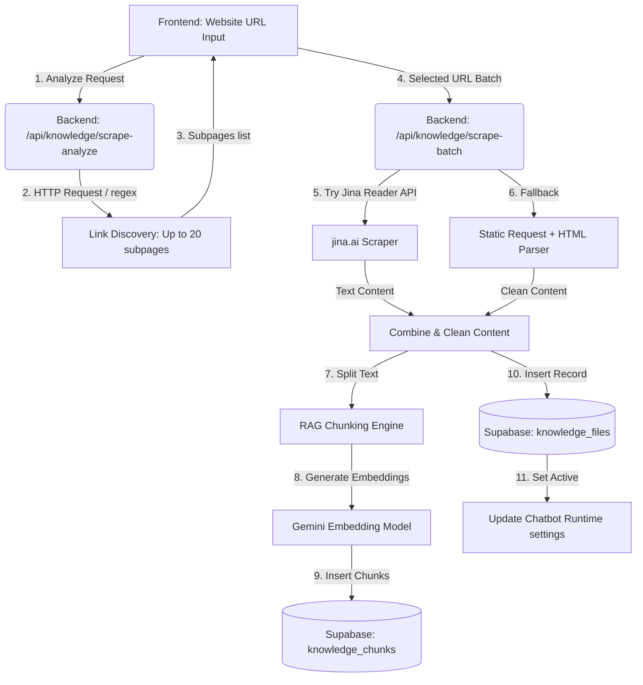

# Web Scraping Pipeline Overview & Progress Report

This document provides a comprehensive overview of the **Web Ingestion and Scraping Pipeline** implemented in the WhatsApp Chatbot project. It details the existing architecture, directory layout, route mappings, current features, and potential areas of development to continue today.

---

## 1. Technical Architecture & Data Flow

The scraping pipeline enables administrators to ingest external website pages into the chatbot's knowledge base. Below is the system flow showing how content is discovered, parsed, chunked, embedded, and stored:

---

## 2. Directory Layout & File Mappings

All features related to the web scraping and knowledge ingestion pipeline are contained within the following files:

| Layer | File / Path | Key Functions / Responsibilities |
| :--- | :--- | :--- |
| **Frontend UI** | [new_linkdocs.html](file:///c:/Users/User/Desktop/Part_Time/Whatsapp_Chatbot/frontend/new_linkdocs.html) | Interactive web scraping modals, tab management, check-box based crawler page selection, and ingestion state updates. |
| **API Routing** | [knowledge_routes.py](file:///c:/Users/User/Desktop/Part_Time/Whatsapp_Chatbot/app/routes/knowledge_routes.py) | Exposes endpoints for listing, adding, setting active, deleting, analyzing, and batch scraping URLs. |
| **Core Logic** | [knowledge_service.py](file:///c:/Users/User/Desktop/Part_Time/Whatsapp_Chatbot/app/services/knowledge_service.py) | High-level orchestration of crawling, parsing, fallback mechanisms, batching, and chunking integration. |
| **Chunking & NLP** | [rag_service.py](file:///c:/Users/User/Desktop/Part_Time/Whatsapp_Chatbot/app/services/rag_service.py) | Splits raw text into cohesive Q&A sections or generic text blocks; calls Gemini model `gemini-embedding-2` for 768-dimensional embeddings. |
| **Database (Files)** | [knowledge_file_repository.py](file:///c:/Users/User/Desktop/Part_Time/Whatsapp_Chatbot/app/database/knowledge_file_repository.py) | Manages rows in `knowledge_files` table (inserting, deleting, setting `is_active` status). |
| **Database (Chunks)** | [knowledge_chunk_repository.py](file:///c:/Users/User/Desktop/Part_Time/Whatsapp_Chatbot/app/database/knowledge_chunk_repository.py) | Manages vectors/chunks in `knowledge_chunks` table (inserting, deleting, querying vector similarity RPCs). |

---

## 3. Implemented Features & Endpoints

### A. Web API Endpoints

1. **`POST /api/knowledge/scrape-analyze`**:
   - **Purpose**: Discovers subpages from a primary domain.
   - **Method**: Fetches raw HTML of the base URL, parses links sharing the same base domain, ignores asset file patterns (e.g., images, CSS, zip), and returns up to 20 sorted internal subpages.

2. **`POST /api/knowledge/scrape-batch`**:
   - **Purpose**: Scrapes content from multiple URLs, combines them, chunks them, and runs embedding creation.
   - **Method**:
     - Loops through URLs, fetching content for each.
     - Saves records under `knowledge_files` (stores name as `primary_url (+N pages)`).
     - Splitting content using `split_text_into_sections()`.
     - Generates vector embeddings via Gemini APIs.
     - Saves chunks in `knowledge_chunks` linked to the file record.
     - Automatically designates the newly scraped URL bundle as the **active** source material for RAG.

3. **`POST /api/knowledge/scrape`**:
   - **Purpose**: A simpler, single-URL version of batch scraping.

4. **`GET /api/knowledge/files`**, **`POST /api/knowledge/set-active`**, **`DELETE /api/knowledge/files/<path:file_name>`**:
   - **Purpose**: Standard file management endpoints that handle both static local PDFs and scraped URLs.

---

### B. Dual-Scraping Engine

The backend implements a highly resilient dual-mode strategy in `fetch_and_parse_url()`:

> [!NOTE]
> **Priority 1: Jina Reader API (`https://r.jina.ai/{url}`)**
> - Used first because it evaluates JavaScript and returns clean, stripped markdown suitable for LLMs.
> - Configured with a 25-second timeout.
>
> **Priority 2: Native HTML Extractor**
> - Invoked as a fallback if the Jina API errors out, times out, or returns less than 50 characters.
> - Fetches static HTML via the `requests` library and uses python's built-in `html.parser.HTMLParser` (`HTMLTextExtractor`) to extract visible text.
> - Excludes irrelevant page components (e.g., `<script>`, `<style>`, `<header>`, `<footer>`, `<nav>`, `<noscript>`, `<head>`, `<iframe>`).

---

### C. UI & UX (Frontend)

- **Website Link Tab**: The Add Resource modal includes a "Website Link" tab.
- **Visual Analyzing Indicator**: Disables inputs and shows a "Finding subpages..." spinner while `/scrape-analyze` processes.
- **Selective Page Picker**: Lists found subpages with individual checkboxes. Features a "Select All" / "Deselect All" control.
- **Combined Ingestion Progress**: Submits the batch list to `/scrape-batch` and updates the active file lists on completion.

---

## 4. Current Progress & Next Steps (What to Continue Today)

The core ingestion infrastructure is complete and clean. If you want to continue building on this pipeline today, here are several recommended options/improvements:

### Option 1: Asynchronous Scraping / Task Queue (Highly Recommended)
Currently, Flask executes scraping synchronously. If a user tries to scrape 15-20 large web pages, Jina API and fallback requests run sequentially inside the Flask thread. This can exceed Flask's gateway timeouts or lock up the main application.
* **Proposed Enhancement**: Move `scrape_website_urls_batch` to a background worker or process. Update the UI to poll a status endpoint (`/api/knowledge/scrape/status/<task_id>`) for real-time progress.

### Option 2: Add Site Map (.xml) Ingestion Support
Many enterprise websites have site maps listing all active pages.
* **Proposed Enhancement**: In `discover_website_links()`, first check if `/sitemap.xml` exists. If yes, parse it to extract high-accuracy urls instantly rather than parsing link tags from the homepage HTML.

### Option 3: RAG Retrieval Tuning & Vector Threshold settings
Currently, vector search is capped at a threshold of `0.45` and `top_k=3` in `retrieve_relevant_chunks()`.
* **Proposed Enhancement**: Provide an admin panel setting or runtime configuration to adjust chunk size (`max_chunk_length`), overlap, similarity threshold, and `top_k` retrieved contexts to test chatbot answer accuracy.

### Option 4: Scraped Content Preview & Edit Modal
Users may want to see exactly what text content was extracted from their pages and manually prune garbage text, cookie banners, or unrelated sidebars.
* **Proposed Enhancement**: Add a "View Content" modal in [new_linkdocs.html](file:///c:/Users/User/Desktop/Part_Time/Whatsapp_Chatbot/frontend/new_linkdocs.html) that fetches the compiled text for active URLs from the backend database and lets the user edit it.
