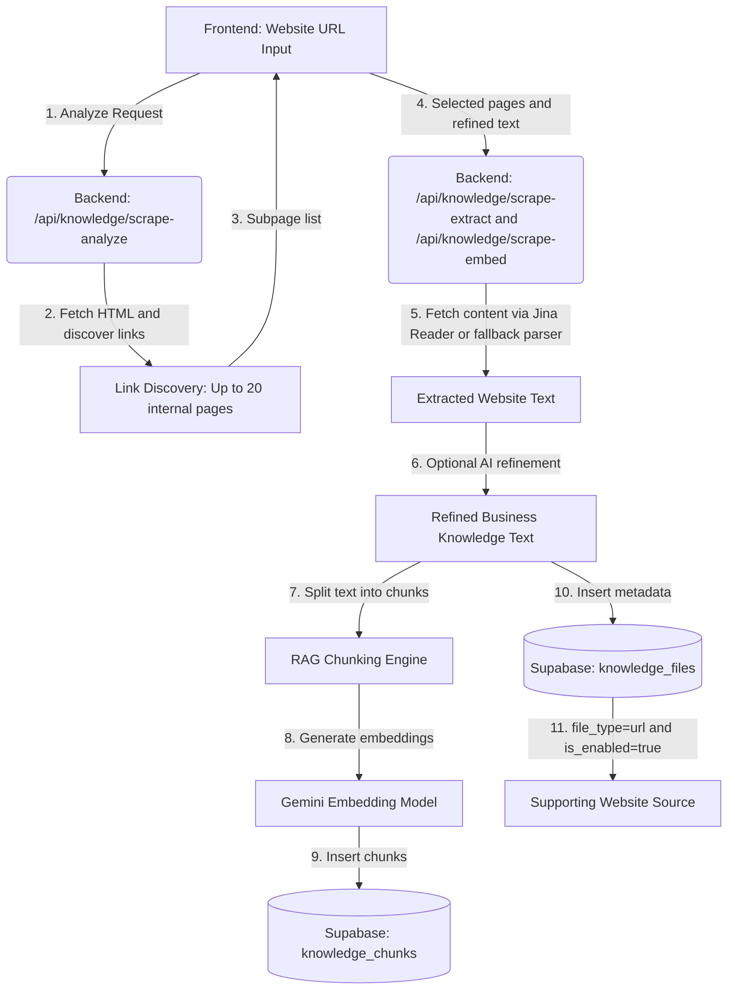

# Website Supporting Knowledge Pipeline Report

This document describes the current website ingestion pipeline in the Flask + Supabase AI chatbot platform.

The knowledge system now separates primary and supporting sources:

- PDF is the primary/main chatbot knowledge source.
- Website/URL sources are supporting knowledge only.
- Website sources do not replace the active PDF.
- Website sources do not update `draft_pdf_file_name` or `draft_pdf_path`.
- Supporting website sources can be enabled or disabled with `knowledge_files.is_enabled`.
- RAG searches the active primary PDF first, then uses enabled supporting website chunks when PDF context is missing, incomplete, or not detailed enough.
- Disabled website sources remain stored but are ignored by RAG.

---

## 1. Current Data Flow



Important: website ingestion saves supporting knowledge. It does not call PDF activation logic and does not overwrite chatbot runtime PDF fields.

---

## 2. File and Module Mapping

| Layer | File / Path | Current Responsibility |
| :--- | :--- | :--- |
| Frontend UI | `frontend/new_linkdocs.html` | Lets users add a primary PDF, add supporting websites, enable/disable supporting websites, and delete knowledge sources. |
| Bot Config UI | `frontend/new_prompt.html` | Shows active primary knowledge plus supporting website counts and enabled website names. |
| Dashboard UI | `frontend/index.html` | Shows active primary knowledge in dashboard and Bot Health. |
| API Routing | `app/routes/knowledge_routes.py` | Exposes knowledge file listing, active primary PDF, set primary PDF, delete source, website scrape/extract/embed, and supporting website toggle routes. |
| Core Logic | `app/services/knowledge_service.py` | Handles PDF upload/set-primary/delete and website ingestion/toggle behavior. |
| RAG Logic | `app/services/rag_service.py` | Retrieves active PDF chunks first, then enabled supporting website chunks. |
| Database: Files | `app/database/knowledge_file_repository.py` | Manages `knowledge_files`, active PDF helpers, supporting website helpers, and `is_enabled` updates. |
| Database: Chunks | `app/database/knowledge_chunk_repository.py` | Manages `knowledge_chunks`, including chatbot-scoped chunk fetch/delete helpers. |

---

## 3. Knowledge Source Rules

### Primary PDF

PDF rows use:

- `knowledge_files.file_type = "pdf"`
- `knowledge_files.is_active = true` for the active primary PDF

The active primary PDF is selected with PDF-specific repository helpers. Setting a PDF as primary deactivates only other PDF rows for the same chatbot.

### Supporting Websites

Website rows use:

- `knowledge_files.file_type = "url"`
- `knowledge_files.is_enabled = true/false`

Website rows are supporting knowledge only. They are not active primary knowledge and should not use `is_active` for RAG participation.

Website rows can be:

- enabled, so RAG can use their chunks after PDF context
- disabled, so they remain stored but are ignored by RAG
- deleted, which removes their metadata and chunks

---

## 4. Current API Endpoints

### `POST /api/knowledge/scrape-analyze`

Discovers internal pages from a submitted website URL.

Current behavior:

- Fetches raw HTML.
- Extracts same-domain links.
- Excludes obvious asset file links.
- Returns up to 20 discovered pages.

### `POST /api/knowledge/scrape-extract`

Fetches selected pages and extracts/refines business knowledge text.

Current behavior:

- Requires explicit `chatbot_id`.
- Verifies chatbot access.
- Parses selected URLs.
- Returns extracted/refined text for user review.

### `POST /api/knowledge/scrape-embed`

Saves reviewed website knowledge as a supporting source.

Current behavior:

- Saves a `knowledge_files` row with `file_type = "url"`.
- Saves chunks in `knowledge_chunks`.
- Sets `is_enabled = true` when the database column exists.
- Does not set `is_active`.
- Does not update `draft_pdf_file_name`.
- Does not update `draft_pdf_path`.
- Returns a supporting-knowledge message.

### `GET /api/knowledge/files`

Lists knowledge sources for the selected chatbot.

Current behavior:

- Returns PDF and website rows.
- Includes `file_type`.
- Includes `is_enabled`.
- Includes `is_active`.

The frontend uses these fields to show:

- PDF rows as `ACTIVE PRIMARY` or `AVAILABLE`
- website rows as `SUPPORTING ENABLED` or `SUPPORTING DISABLED`

### `POST /api/knowledge/set-active`

Sets a PDF as the active primary knowledge source.

Current behavior:

- Only allows PDF rows.
- Rejects website rows.
- Updates `draft_pdf_file_name` and `draft_pdf_path` only for PDF rows.

### `POST /api/knowledge/toggle-support`

Enables or disables a supporting website source.

Request body:

```json
{
  "file_name": "https://example.com",
  "is_enabled": false
}
```

Current behavior:

- Requires explicit `chatbot_id`.
- Verifies chatbot access.
- Only allows `file_type = "url"`.
- Updates `is_enabled`.
- Does not touch `is_active`.

### `DELETE /api/knowledge/files/<file_name>`

Deletes a PDF or website knowledge source.

Current behavior:

- Resolves the knowledge file by chatbot and name/id.
- Deletes related chunks by `chatbot_id` and `file_id`.
- Deletes the `knowledge_files` row.
- Removes a local file only when a local file path exists.
- Does not fail the entire delete when the local file is already missing.

---

## 5. Scraping and Extraction

The backend uses a two-step extraction strategy in `fetch_and_parse_url()`:

1. Jina Reader API: `https://r.jina.ai/{url}`
2. Fallback static request + `HTMLTextExtractor`

The fallback parser removes common non-content areas such as:

- script
- style
- header
- footer
- nav
- noscript
- head
- iframe

The extracted text must contain enough useful content before it can be saved.

---

## 6. RAG Retrieval Behavior

RAG retrieval is handled in `app/services/rag_service.py`.

Current behavior:

1. Load the active primary PDF using `get_active_pdf_knowledge_file(chatbot_id)`.
2. Retrieve relevant chunks from the active PDF first.
3. If PDF context is missing or fewer than the requested top-k context slots, load supporting website files using `get_supporting_knowledge_files(chatbot_id)`.
4. `get_supporting_knowledge_files(chatbot_id)` returns only URL rows where `is_enabled = true`.
5. Retrieve chunks from enabled supporting website sources.
6. Disabled supporting websites are ignored.

The prompt labels context as:

- Primary PDF knowledge
- Supporting website knowledge

This helps the model treat PDF content as the main source and website content as supplemental/latest detail.

---

## 7. Frontend Behavior

### Links / Documents Page

`frontend/new_linkdocs.html` now separates PDF and website behavior:

- PDF rows show `ACTIVE PRIMARY` or `AVAILABLE`.
- PDF rows can be set as primary.
- Website rows show `SUPPORTING ENABLED` or `SUPPORTING DISABLED`.
- Website rows can be enabled or disabled.
- Website rows can be deleted.
- Website rows do not show `Set as Primary`.

### Bot Configuration Page

`frontend/new_prompt.html` shows:

- Active Primary Knowledge
- Active Profile
- Supporting Websites count
- Enabled supporting website list
- Disabled supporting website count when applicable

### Dashboard

`frontend/index.html` shows primary knowledge wording in Bot Health and dashboard cards.

---

## 8. Current Limitations and Future Improvements

### Synchronous Website Processing

Website extraction still runs during the request flow. Large websites or many selected pages may take too long.

Future improvement:

- Move website processing to a background worker.
- Add a task status table.
- Let the frontend poll processing status.

### Storage

PDF upload still uses the local `data/` folder for current processing.

Future improvement:

- Move original PDF files to Supabase Storage or S3.
- Keep Supabase tables as the source of metadata and chunks.

### Content Preview and Editing

The frontend already supports reviewing refined website text before saving. A future enhancement could add a saved-source preview/edit feature for already-ingested website sources.

### Retrieval Tuning

Current RAG retrieval uses fixed chunk and similarity behavior in code.

Future improvement:

- Add admin tuning for `top_k`, similarity threshold, and chunking strategy.

---

## 9. Summary

The website ingestion pipeline is now a supporting-knowledge system. It adds supplemental website knowledge without replacing the active primary PDF.

The current design supports:

- one active primary PDF per chatbot
- multiple supporting website sources
- enable/disable control for supporting websites
- RAG retrieval that prefers PDF knowledge first
- safe deletion of metadata and chunks

This matches the current product rule for PDF-primary and website-supporting chatbot knowledge.
